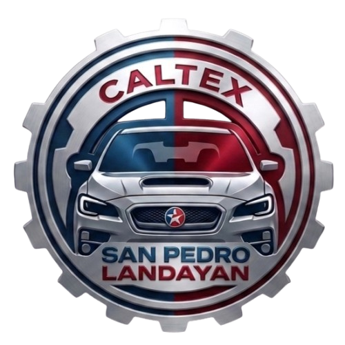

<div align="center">
  

  <h1>Integrated Vehicle Maintenance &amp; Inventory Management System</h1>

  <h3>Decision Support for JA Noble Enterprise Inc.</h3>

  <p><strong>A BS Information Technology capstone project</strong><br>
  Laguna State Polytechnic University — San Pablo City Campus</p>

  <p><a href="https://janobleenterpriseinc.onrender.com/"><strong>View the Live Website →</strong></a></p>

  <p>
    <a href="https://developer.mozilla.org/docs/Web/HTML"></a>
    <a href="https://developer.mozilla.org/docs/Web/CSS"></a>
    <a href="https://developer.mozilla.org/docs/Web/JavaScript"></a>
    
  </p>

  <p>
    <a href="site/index.html">Project Website</a> ·
    <a href="site/gallery.html">Screenshots Gallery</a> ·
    <a href="LICENSE">License</a>
  </p>
</div>

---

## About

The **Integrated Vehicle Maintenance and Inventory Management System (IVMIMS)**
supports JA Noble Enterprise Inc. in coordinating vehicle maintenance and
inventory operations. The system combines web and mobile interfaces with
decision support for stock replenishment and preventive maintenance scheduling.

The project website introduces the research, system features, project team, and
screenshots of the web and mobile applications.

## System highlights

| Area | What it supports |
| --- | --- |
| Vehicle maintenance | Digital work orders, vehicle-linked service history, and service status tracking |
| Mobile inventory | QR/barcode scanning, stock monitoring, and inventory updates |
| Decision support | Low-stock alerts, reorder recommendations, and preventive maintenance notifications |
| RAG AI assistant | Database-grounded conversational responses and management reports |
| Customer portal | Secure access to vehicle service history and upcoming maintenance due dates |

## View the website

This is a static website; no package installation or build step is required.

1. Download or clone this repository.
2. Open `site/index.html` in a browser.
3. Use the **Screenshots** link on the website or open `site/gallery.html` to view the interface gallery.

## Project team

| Member | Role |
| --- | --- |
| Carla Mae R. Villafranca | Quality Assurance; Research & Communication |
| Mariely Ann L. Tolentino | Web & Mobile Full Stack Developer; Project Head |
| Precious C. Rondilla | AI Developer; Research & Communications |
| Reynalen Calupig Justo, DIT | Capstone Adviser |

## Repository layout

```text
.
├── LICENSE
├── README.md
└── site/
    ├── index.html             # Project overview
    ├── gallery.html           # Web and mobile screenshots
    ├── css/                   # Website styles
    ├── js/                    # Website and gallery interactions
    └── assets/
        ├── images/            # Logo and background imagery
        ├── team/              # Team and adviser photos
        ├── screenshots/       # Application screenshots
        └── D11_FinalManuscript.pdf
```

## Ownership and license

The project team asserts ownership of the original project source, documentation,
and materials created for this capstone. Those original materials are protected
by the custom **All Rights Reserved** license in [`LICENSE`](LICENSE). No
permission to copy, modify, distribute, or reuse them is granted without prior
written permission, except where applicable law provides otherwise.

Third-party names, trademarks, logos, photographs, fonts, libraries, and other
materials remain the property of their respective owners and are not relicensed
by this project license. Their inclusion does not imply endorsement.

---

<div align="center">
  <sub>Developed in partnership with JA Noble Enterprise Inc. · Laguna State Polytechnic University, College of Computer Studies</sub>
</div>
